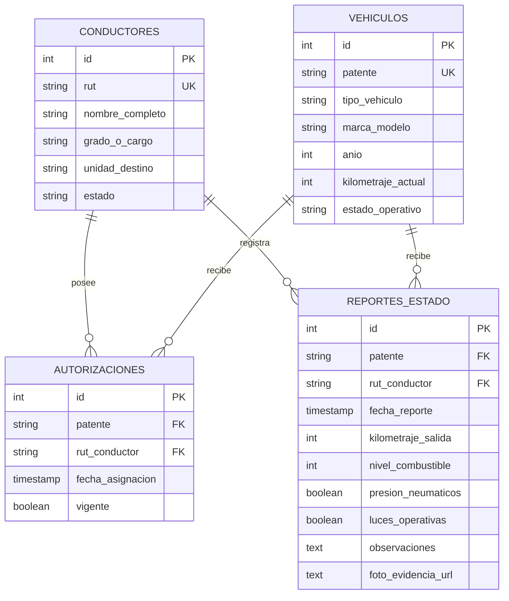

# Diagrama entidad-relación

El modelo utilizado por la aplicación se basa en las tablas proporcionadas para la actividad.

Las columnas deben mantenerse alineadas con el esquema efectivamente disponible en el proyecto Supabase entregado para la actividad.
